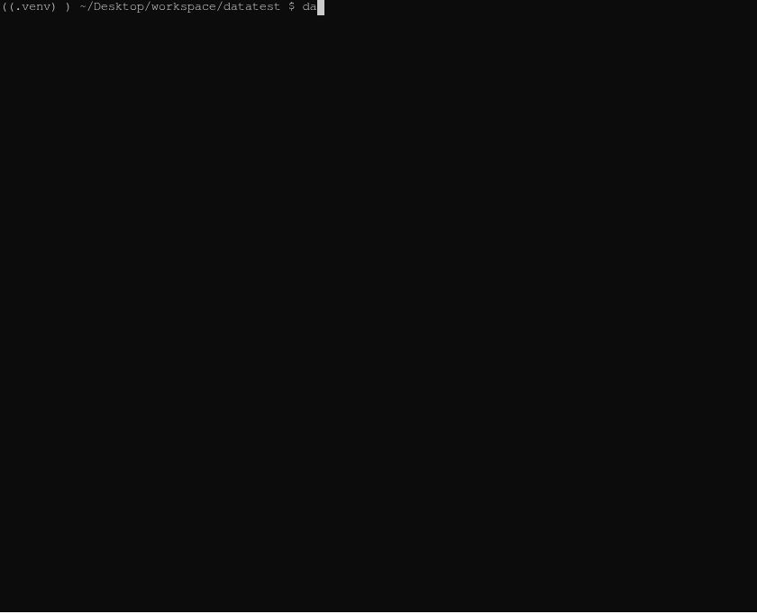

# Data

Data is a tiny replacement for "file" from coreutils
that only relies on POSIX / LibC functions.

 <!-- termtosvg && https://ezgif.com/svg-to-gif -->

<!--


[](https://github.com/unistd-h/data/actions/workflows/c-cpp.yml)
-->

### Usage:
```bash
data [file] #lookup file
data --help #show help
data -h #show help
data --license #show license
data -l #show license
```
### Building from source:
```bash
make #make bin
make clean #clean
make install #install into /bin/
make remove #remove from /bin/
```
### Format support:
> See [./src/magic.h](src/magic.h)

- Images:		BMP, GIF, JPEG, PNG, QOI, TIFF, WebP
- Audio:		AIFF, FLAC, WAV, MIDI, ogg, QOA, MP3
- Video:		AVI, MP4
- Multimedia:	Blender, FL Studio, glTF, docx, Photoshop, PDF, Quake MDL, Rich Text
- Fonts:		OpenType, WOFF, WOFF2
- Executables:	ELF, EXE, WebAssembly, Luac
- Archives:		Tar, ZIP, GZIP, XZ, LZIP, 7-Zip, RAR, BZip, CPIO, PAK, .deb, .rpm
- Binary Data:	qcow, ISO
- Other:		XML, Shebang scripts, SSH keys, Shortcuts
